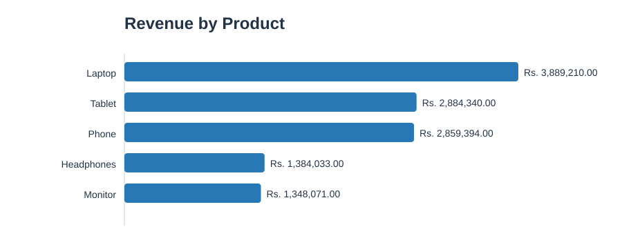

# Sales Data Analysis Report

## 1. Project Overview

This project uses Python and Pandas to clean and analyze
a sample sales dataset and identify useful business insights.

## 2. Data Cleaning

- Original rows: 100
- Exact duplicate rows removed: 0
- Valid rows analyzed: 100
- Rows with missing product names excluded: 0
- Missing or non-numeric quantity values: 0
- Missing or non-numeric unit price values: 0
- Rows with non-positive quantities or negative prices excluded: 0
- Revenue was recalculated using Quantity × Unit_Price.

## 3. Key Performance Metrics

| Metric | Result |
|---|---:|
| Total revenue | Rs. 12,365,048.00 |
| Total units sold | 478 |
| Average sale value | Rs. 123,650.48 |
| Highest sale | Rs. 373,932.00 |
| Lowest sale | Rs. 6,540.00 |
| Valid sales records | 100 |
| Duplicate rows removed | 0 |

## 4. Product Performance

**Top product by revenue:** Laptop (Rs. 3,889,210.00)

**Best-selling product by quantity:** Laptop

**Units sold:** 136

### Revenue by Product

| Product | Revenue (Rs.) |
|---|---:|
| Laptop | 3,889,210.00 |
| Tablet | 2,884,340.00 |
| Phone | 2,859,394.00 |
| Headphones | 1,384,033.00 |
| Monitor | 1,348,071.00 |

## 5. Business Insights

- Total recorded revenue is Rs. 12,365,048.00.
- Laptop generated the highest product revenue.
- Laptop had the highest total quantity sold.
- Average sale value was Rs. 123,650.48.

## 6. Conclusion

Pandas helped load, clean, group, and summarize sales records.
These results can help a business understand product performance
and make more informed inventory and sales decisions.

## 7. Tools Used

- Python
- Pandas
- CSV
- Markdown

## 8. Validation

The report and chart were generated from the cleaned dataset.
Revenue was recalculated from quantity multiplied by unit price.
